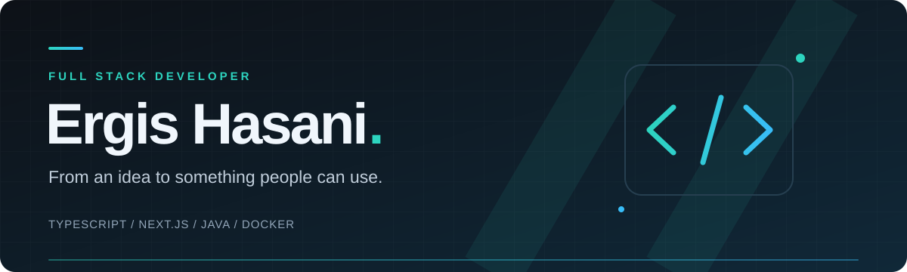
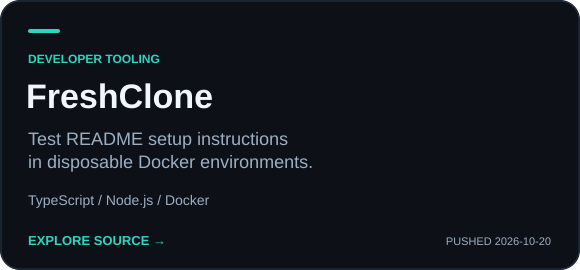
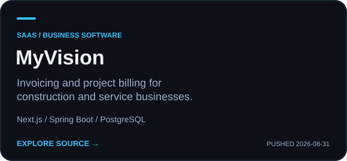
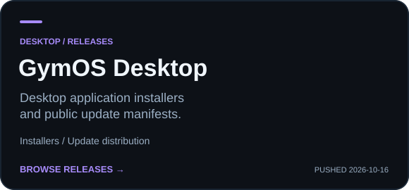
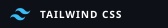
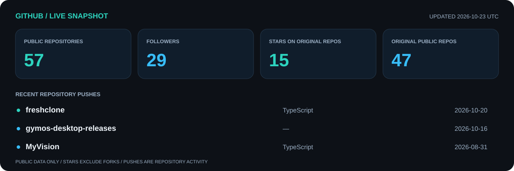

<p align="center">
  
</p>

<p align="center">
  <a href="https://github.com/ergishasani?tab=repositories"></a>
  <a href="https://www.linkedin.com/in/ergis-hasani-bb9ba0174/"></a>
  <a href="mailto:ergishasani@icloud.com"></a>
</p>

<p align="center">
  <a href="#about">About</a> ·
  <a href="#selected-work">Selected work</a> ·
  <a href="#toolbox">Toolbox</a> ·
  <a href="#activity">Activity</a> ·
  <a href="#lets-build-something">Let's build something</a>
</p>

## About

I'm **Ergis Hasani**, a developer based in **Tirane, Albania**. I build developer tools and full stack applications, with recent public work in onboarding automation, SaaS billing, and desktop distribution.

<p align="center">
  
  
  
</p>

## Selected work

<p align="center">
  <a href="https://github.com/ergishasani/freshclone"></a>
  <a href="https://github.com/ergishasani/MyVision"></a>
</p>
<p align="center">
  <a href="https://github.com/ergishasani/gymos-desktop-releases/releases/latest"></a>
</p>

<p align="center">
  <a href="https://github.com/ergishasani?tab=repositories"><b>Explore all repositories →</b></a>
</p>

<details>
<summary>Project details & development status</summary>

- **[FreshClone](https://github.com/ergishasani/freshclone):** TypeScript CLI for running README setup commands in disposable Docker environments. Current source supports Node.js/Python, named scenarios, PostgreSQL/Redis services, assertions, and GitHub reporting. Early development; source version 0.2.0 is not yet published to npm.
- **[MyVision](https://github.com/ergishasani/MyVision):** SaaS invoicing and project billing for construction and service businesses. Next.js, TypeScript, Tailwind CSS, Java 21, Spring Boot 3, PostgreSQL, Flyway, and JWT authentication.
- **[GymOS Desktop releases](https://github.com/ergishasani/gymos-desktop-releases):** Public installers and update manifests. Follow the card to the latest release and downloadable assets.

Descriptions are based on the linked project documentation; card push dates refresh from GitHub.

</details>

## Toolbox

<p align="center"><b>INTERFACES</b></p>
<p align="center">
  
  
  
</p>
<p align="center"><b>APIs & DATA</b></p>
<p align="center">
  
  
  
  
  
</p>
<p align="center"><b>BUILD & SHIP</b></p>
<p align="center">
  
  
  
</p>

<p align="center"><sub>Technologies documented in FreshClone and MyVision.</sub></p>

## Activity

<!-- LIVE-DATA:START -->

<p align="center"><a href="https://github.com/ergishasani"></a></p>

<details>
<summary>View source data and recent repositories</summary>

Public GitHub snapshot · **2026-10-21 (UTC)**

**57 public repositories** · **29 followers** · **57 following**

### Recently pushed public projects

| Repository | GitHub description | Main language | Last push (UTC) |
| :--- | :--- | :--- | :--- |
| [freshclone](https://github.com/ergishasani/freshclone) | Test your README setup instructions in a clean environment. Catch broken onboarding before your next contributor does. | TypeScript | 2026-10-20 |
| [gymos-desktop-releases](https://github.com/ergishasani/gymos-desktop-releases) | GymOS Desktop installers and update manifest | — | 2026-10-16 |
| [MyVision](https://github.com/ergishasani/MyVision) | No repository description provided. | TypeScript | 2026-08-31 |
| [TeamSystem](https://github.com/ergishasani/TeamSystem) | No repository description provided. | HTML | 2026-06-21 |
| [GymOs-Backend](https://github.com/ergishasani/GymOs-Backend) | No repository description provided. | Java | 2026-05-12 |

Source: [GitHub profile API](https://api.github.com/users/ergishasani) and [public repository API](https://api.github.com/users/ergishasani/repos?sort=pushed&per_page=100). Forks, archived repositories, and this profile repository are excluded from the table. Push dates describe repository activity, not individual contribution counts.

</details>

<!-- LIVE-DATA:END -->

[View contribution history](https://github.com/ergishasani?tab=overview) · [Browse repositories](https://github.com/ergishasani?tab=repositories)

<details>
<summary>How the dashboard stays current</summary>

The [refresh workflow](./.github/workflows/profile.yml) fetches GitHub's public API daily at **06:15 UTC**, on relevant pushes, or through **Run workflow**. It regenerates the dashboard, project push dates, and the source-data section together. Scheduled runs may be delayed by GitHub.

Only public data is used. Forks are excluded from original-repository and star totals. Push dates represent repository activity. The dashboard shows its snapshot date; project summaries remain curated from their documentation.

No custom API token is needed. The workflow uses the repository's standard `GITHUB_TOKEN` to save generated files, subject to repository write permissions and branch rules. API failures leave the existing content intact.

Local refresh with Node.js 22 or newer:

```sh
node scripts/update-profile.mjs
```

</details>

## Let's build something

<p align="center">
  <b>Have a tool to build or a workflow to simplify?</b><br />
  Tell me the idea, the problem, and where you need a hand.
</p>
<p align="center">
  <a href="mailto:ergishasani@icloud.com?subject=Let%27s%20build%20something"></a>
  <a href="https://www.linkedin.com/in/ergis-hasani-bb9ba0174/"></a>
</p>

---

<p align="center"><sub>Built around real projects. Kept current with public GitHub data.</sub></p>
